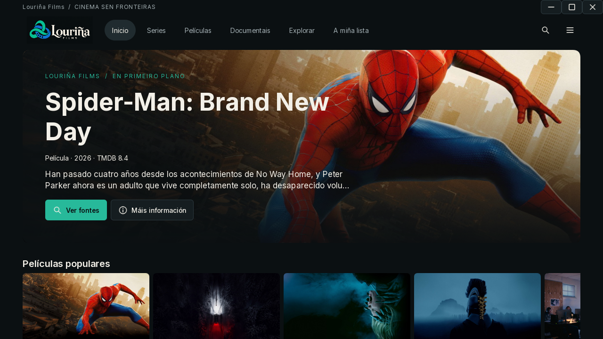

# Louriña Films

Aplicación de escritorio para descubrir cinema, organizar unha colección local e reproducir fontes públicas compatibles. Emprega Python, PySide6/QML, SQLite e Qt Multimedia/WebEngine. Non precisa unha conta propia da aplicación.



**Versión 0.5.1 · candidata de compatibilidade Linux**

Esta revisión conserva a interface e as funcións da versión 0.5.0 e incorpora
unha compilación Linux baseada en GLIBC 2.31.
Os paquetes prepáranse sen contas, claves, bases de datos nin datos persoais.
A publicación en GitHub é un paso separado: consulta [Releases](https://github.com/EidoAut/Louri-aFilms/releases)
para ver as versións que xa están publicadas.

| Plataforma | Paquete |
| --- | --- |
| Windows x86_64 · portable | `lourihna-films-0.5.0-windows-x86_64-portable.zip` |
| Linux x86_64 · portable | `LourinhaFilms-linux-x86_64-glibc231.tar.gz` |
| Código fonte | `lourihna-films-0.5.0-source.zip` |
| Verificación de integridade | `SHA256SUMS.txt` |

[Notas da versión](docs/RELEASE-0.5.0.md) · [Requisitos e instalación](#descargas-e-requisitos)

## Funcións

- Busca de vídeos públicos en OK.ru e fontes alternativas de Internet Archive. A dispoñibilidade depende de cada provedor.
- Catálogos opcionais de películas e series con metadatos de TMDB. Unha ficha de TMDB **non garante** que exista un vídeo reproducible.
- Favoritos, historial, progreso, categorías locais, importación de ligazóns e exploración con carga progresiva.
- Portada panorámica, filas horizontais, tarxetas ampliadas e fichas superpostas con episodios dispoñibles.
- Actualizacións de interface por campo e caché de imaxes para reducir tiróns.
- Saída de audio automática ou manual no reprodutor nativo, incluído HDMI cando o sistema o detecta.
- Borrado separado de buscas e reproducións, con confirmación e conservación da colección.
- Reprodutor integrado, formatos e calidades que a fonte expoña publicamente, e reprodutor oficial cando corresponda. Non elimina restricións de acceso nin DRM.
- Tradución local opcional das sinopses mediante modelos descargados cando fan falta. A primeira tradución require conexión e pode tardar.
- Interface en galego ou castelán e benvida co logotipo durante polo menos tres segundos.


## Descargas e requisitos

Consulta as notas de cada versión para coñecer o sistema de compilación e as comprobacións realizadas.

### Windows

1. Descarga `lourihna-films-0.5.0-windows-x86_64-portable.zip` cando estea publicado.
2. Extrae **todo** o arquivo nun cartafol; conserva `_internal` xunto ao executable.
3. Abre `lourihna_films/lourihna_films.exe`. Non precisa instalación nin permisos de administrador.
4. Abre **☰ → Axustes** para configurar TMDB se queres utilizar ese catálogo.

Compilación x86_64 con Python 3.12; validación local en Windows 11. Non hai unha
compilación ARM nativa nin certificación de todas as versións de Windows. O
portable non está asinado cun certificado comercial. GitHub Actions tamén pode
xerar o instalador por usuario `lourihna-films-0.5.0-windows-x86_64-setup.exe`
con Inno Setup; non se debe anunciar como dispoñible ata que se xere e publique.

### Linux

O novo paquete ten como base **Ubuntu 20.04 x86_64 e GLIBC 2.31**. Ubuntu
22.04 e 24.04 forman parte da matriz automática de probas. Consulta os resultados
da compilación e as notas da versión: a base de compilación non certifica todos
os escritorios, controladores gráficos nin servizos de vídeo.

Descarga `LourinhaFilms-linux-x86_64-glibc231.tar.gz` e o seu ficheiro `.sha256`
da mesma compilación. Non precisas instalar Python nin dependencias Python:

```sh
sha256sum -c LourinhaFilms-linux-x86_64-glibc231.tar.gz.sha256
tar -xzf LourinhaFilms-linux-x86_64-glibc231.tar.gz
cd lourinha-films
./install.sh
```

Abre **Louriña Films** no menú multimedia. Desde un terminal:

```sh
"$HOME/.local/opt/lourinha-films/lourihna_films"
```

O instalador non precisa `sudo`. Instala en `~/.local/opt/lourinha-films` e crea
`~/.local/share/applications/lourinha-films.desktop`, co logotipo incluído.
Para actualizar, extrae o paquete novo noutro cartafol e executa `./install.sh`:
substitúe o runtime completo e conserva a colección e os axustes.
Para desinstalar:

```sh
"$HOME/.local/opt/lourinha-films/uninstall.sh"
```

Os datos persoais quedan en `~/.local/share/lourihna_films` ou no destino
configurado mediante XDG/LOURIHNA_FILMS_DATA_DIR. O executable conserva o nome
histórico `lourihna_films` para evitar cambios de identidade ou de perfil.
O instalador antigo usaba `~/.local/opt/lourihna-films`; non se elimina esa
instalación automaticamente. Se segue aparecendo unha entrada antiga no menú,
retíraa só despois de comprobar a nova instalación.

Precísase un escritorio X11 ou XWayland, controladores OpenGL/Mesa e un servizo
de audio PulseAudio ou PipeWire compatible. As bibliotecas do sistema pódense
instalar en Ubuntu 20.04/22.04 con:

```sh
sudo apt-get install libglib2.0-0 libdbus-1-3 libfontconfig1 libfreetype6 \
  libxfixes3 libcups2 libgtk-3-0 libegl1 libgl1 libopengl0 libnss3 libasound2 \
  libpulse0 libxkbcommon-x11-0 libxcb-cursor0 libxcb-icccm4 libxcb-keysyms1 \
  libxcb-shape0 libxcb-randr0 libxcb-xinerama0 libxcomposite1 libxdamage1 libxrandr2 \
  libxtst6 libxshmfence1 libgbm1 libdrm2 libxkbfile1
```

En Ubuntu 24.04 os nomes correspondentes son `libglib2.0-0t64`, `libcups2t64`,
`libgtk-3-0t64` e `libasound2t64`. Só a instalación de bibliotecas do sistema
precisa permisos de administrador; a aplicación non. FFmpeg para reprodución
vai incluído co runtime de Qt; non se precisa a orde `ffmpeg` no equipo final.

Se aparece `GLIBC_2.38 not found`, comproba que descargaches o novo paquete
`glibc231`, non o antigo 0.5.0. **Non substitúas GLIBC manualmente**.
Un erro do complemento `xcb` adoita indicar bibliotecas gráficas ausentes:
instala as dependencias anteriores. Para diagnosticar, executa o programa nun
terminal con `QT_DEBUG_PLUGINS=1`. Non execúte-lo como root nin desactives o
sandbox de Chromium. Unha proba con Xvfb non verifica altofalantes físicos,
HDMI, aceleración GPU nin a dispoñibilidade de vídeos externos.

Non hai paquete ARM nin soporte para musl/Alpine. O arquivo portable conserva
`_internal` completo e evita a dependencia de FUSE dunha AppImage.

Os anexos automáticos **Source code (zip)** e **Source code (tar.gz)** son código fonte, **non instaladores**. Se unha plataforma non ten un paquete publicado, podes construílo seguindo as instrucións de desenvolvemento; non descargues un paquete doutra arquitectura.

## Uso diario

- **Tarxetas:** agarda brevemente co cursor para amplialas. Tab enfoca os controis,
  Espazo ou frecha abaixo abre a previsualización, Intro abre a ficha e Escape péchaa.
- **Filas:** usa as frechas ou o desprazamento horizontal; Maiús + roda move a fila.
- **Audio HDMI:** conecta o televisor e abre **Audio** no reprodutor nativo.
  **Automática** segue a saída predeterminada do sistema; tamén podes escoller un
  dispositivo concreto. O reprodutor web usa a saída de Chromium/sistema.
- **Historiais:** abre **☰ → Eliminar historiais…** ou os botóns de Busca/A miña lista.
  Podes borrar buscas, reproducións ou ambas. O borrado de reproducións elimina
  tamén o progreso e Continuar vendo; conserva favoritos, colección e axustes.
- As previsualizacións son imaxes estáticas cando non hai un tráiler verificado.
  Os textos do catálogo dependen do idioma e dos datos que ofreza o provedor.

## TMDB

En **Axustes**, o campo «Clave ou token de TMDB» admite:

- **API Read Access Token**: introdúceo sen o prefixo `Bearer`. A aplicación envíao na cabeceira `Authorization: Bearer …`.
- **API Key v3**: introduce a clave de 32 caracteres hexadecimais. A aplicación envíaa no parámetro `api_key`.

Tamén podes configurar `TMDB_TOKEN` ou `TMDB_API_KEY` no contorno; o token ten prioridade. Non é necesario cambiar o método de autenticación. As credenciais gárdanse con DPAPI en Windows; noutros sistemas a interface só as conserva durante a sesión, ou podes empregar variables de contorno. Non compartas ficheiros `.env` con valores reais.

Consulta a [autenticación oficial](https://developer.themoviedb.org/docs/authentication-application) e as [condicións e atribucións de TMDB](https://developer.themoviedb.org/docs/faq). A API de desenvolvemento permite uso non comercial con atribución; un uso comercial require acordar a licenza correspondente con TMDB.


> This product uses the TMDB API but is not endorsed or certified by TMDB.

As imaxes e os metadatos de terceiros non se relicencian baixo MIT.

## Executar desde as fontes

Require Python 3.12 ou posterior compatible coas dependencias; as comprobacións de distribución usan Python 3.12.

```sh
python -m venv .venv
# Windows PowerShell: .venv\Scripts\Activate.ps1
# Linux: . .venv/bin/activate
python -m pip install -e ".[dev]"
python main.py
```

En Linux tamén se precisa `libpulse0` para Qt Multimedia. Instala as bibliotecas de Qt indicadas na sección Linux anterior. A reprodución require un escritorio gráfico e as bibliotecas multimedia do paquete. As descargas e os servizos externos precisan conexión á Internet.

## Datos e migración

O destino principal é `%LOCALAPPDATA%/lourihna_films` en Windows e `$XDG_DATA_HOME/lourihna_films` en Linux, ou `~/.local/share/lourihna_films` se a variable non está definida. `LOURIHNA_FILMS_DATA_DIR` permite escoller un directorio illado.

A primeira apertura copia a biblioteca da identidade anterior mediante unha copia coherente de SQLite. Conserva os orixinais e non substitúe unha base existente no destino. Inclúe preferencias, favoritos, historial, catálogo e as cachés auxiliares dispoñibles. Os detalles da compatibilidade están en [EIDO e migración](docs/EIDO-MIGRATION.md).

## Desenvolvemento e empaquetado

Le [AGENTS.md](AGENTS.md) e a [guía EIDO Python](docs/standards/EIDO_Python_Programming_Style_Guide_v1.0.txt). Os comentarios e contratos técnicos están en inglés.

```sh
python -m ruff check .
python -m ruff format --check .
python -m pytest -q
python scripts/verify_ui.py --compact --stress-explore
python scripts/verify_controls.py
python scripts/package_release.py --check-source
python -m PyInstaller --noconfirm lourihna_films.spec
python scripts/package_release.py --runtime dist/lourihna_films
python scripts/package_release.py --source
```

Windows: executa `ISCC packaging/windows.iss` con Inno Setup despois de PyInstaller. O instalador queda en `dist/packages/`. Comproba a aplicación con `python scripts/verify_executable.py dist/lourihna_films/lourihna_films.exe`.

Linux: desde un clon Git, con Docker en modo Linux, executa:

```sh
bash scripts/build-linux.sh
```

En Windows pódese executar desde WSL con Docker dispoñible. A imaxe fixa Ubuntu
20.04 por digest, un arquivo APT datado, Python 3.12.15 compilado nese sistema e
wheels con versións e SHA-256 fixados en `packaging/requirements-linux.lock`.
Consérvase Python 3.12 porque xa é o contrato do proxecto e o empaquetador usa
`tomllib` e outras API posteriores a 3.10; non fai falta rebaixalo para GLIBC 2.31.
PySide6 6.8.3 conserva Qt/QML, WebEngine e Multimedia. PyInstaller 6.16.0 xera
un directorio autónomo. OpenSSL 3.5.9 compílase tamén sobre Focal para que Qt
poida cargar carátulas e conexións HTTPS. Non se incorporan bibliotecas do runner.

Os resultados quedan en `dist/linux-glibc231/`. A auditoría analiza todos os ELF,
non só o executable, e rexeita GLIBC > 2.31, arquitecturas incorrectas,
ligazóns externas e dependencias non resoltas. `BUILD-INFO.json`, `ELF-AUDIT.json`,
`SYSTEM-PACKAGES.txt` e `PYTHON-REQUIREMENTS.txt` conservan a trazabilidade.
A data real da compilación impide prometer arquivos idénticos byte por byte.
O bootstrap de certificados APT usa o repositorio oficial de Focal; o resto das
bibliotecas nativas usa o snapshot fixado.

Para repetir a proba nun sistema concreto (cambia 20.04 por 22.04 ou 24.04):

```sh
docker build --build-arg UBUNTU_VERSION=20.04 -f packaging/Dockerfile.linux-test -t lourinha-test .
docker run --rm --shm-size=512m -v "$PWD/dist/linux-glibc231:/input:ro" lourinha-test
```

Estas probas instalan como usuario sen privilexios, lanzan Qt con Xvfb,
comproban vídeo local, a entrada do menú, actualización e desinstalación.
As integracións externas e o audio físico deben verificarse por separado antes
dunha publicación estable. Consulta [a auditoría Linux](docs/LINUX-COMPATIBILITY.md).

[GitHub Actions](https://github.com/EidoAut/Louri-aFilms/actions) constrúe e verifica cada plataforma con permisos de lectura. A publicación da release realízase despois de revisar os resultados; os workflows non precisan claves persoais de TMDB.

## Preparar o repositorio

O repositorio só debe conter código, probas, documentación e recursos da marca.
Non engadas `.env`, bases SQLite, historiais, rexistros, cachés, modelos de tradución,
`.venv`, `build/`, `dist/` nin paquetes binarios. `.gitignore` e o exportador de fontes
comproban estes límites. Os binarios van nos anexos de Releases, non nos commits.

A base de datos créase automaticamente, baleira, na primeira apertura dun perfil
novo. A migración conserva o perfil existente dos usuarios que actualizan.
Para unha proba totalmente limpa, define `LOURIHNA_FILMS_DATA_DIR` cun cartafol
novo: non é preciso borrar nin distribuír unha base de datos.

Cada portable inclúe `BUILD-INFO.json` coas versións usadas. Verifica os anexos con
`Get-FileHash -Algorithm SHA256 <ficheiro>` en PowerShell ou `sha256sum -c SHA256SUMS.txt`
en Linux. Le [o proceso de publicación](docs/RELEASING.md) antes de crear a release.

## Licenza e créditos

Código propio baixo [MIT](LICENSE), copyright © 2026 Samuel Seijo Ribeiro. Desenvolvido por EIDO Automation.

O logotipo actual foi facilitado polo titular do proxecto e consérvase sen modificacións neste cambio. Qt/PySide, FFmpeg, Chromium/WebEngine, Inter e as demais dependencias manteñen as súas propias licenzas e avisos en [docs/licenses](docs/licenses/THIRD-PARTY.md). Os modelos de tradución descárganse por separado e non están incluídos na distribución.

As bibliotecas LGPL distribúense como bibliotecas dinámicas substituíbles. As instrucións anteriores permiten reconstruír a aplicación; non se impide depurar modificacións desas bibliotecas. As fontes e os avisos dos compoñentes correspondentes están enlazados no documento de terceiros. MIT non concede dereitos sobre películas, metadatos, marcas nin contidos dos provedores.
